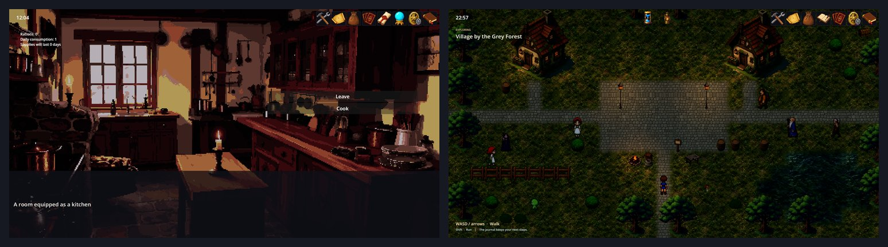

# 2D Shell — каркас, в котором рисуется каждая 2D-игра

2D Shell — это пустой экран, который 2D-игры наполняют: картинка текущего места, часы и панель инструментов сверху, место под панели и уголок уведомлений. Сам по себе он ничего не показывает. Контентные моды вставляют в него свои слои — Dialog Engine приносит текстовое окно и варианты выбора визуальной новеллы, а мод RPG — тайловую карту, по которой можно ходить, — поэтому новелла и тайловая RPG пользуются одним каркасом, одной панелью инструментов и одними меню.

Он входит в каждую 2D-игру: Cthangover, My Novel и RPG Plus.



## Что видно на экране


Вот что даёт оболочка в этой сцене:

- **картинка места** — кухня со своей подсветкой в зависимости от времени суток и огнями (Time Engine);
- **верхняя полоса** — часы слева вверху, панель инструментов справа вверху, а посередине индикатор сохранения и по ночам переносной фонарь;
- **уголок уведомлений** под часами;
- **место для панелей** — сумка, карта или журнал открываются поверх сцены.

Текстовое окно и варианты выбора добавляет Dialog Engine, счётчик пайков — Cooking: это слои, которые эти моды кладут в оболочку.

## Слои: от задних к передним

```text
BaseScene
└── Scene
    ├── ModFirstPanel        слои модов позади всего остального
    ├── ViewBox              само место: освещение, фон, передний план, Lastground
    ├── (content layer)      слой контентного мода, например холст диалогов или мир RPG
    ├── TopView              часы, панель инструментов, индикатор сохранения, фонарь
    ├── ModBeforeUIPanel     панели инструментов: сумка, карта, журнал, меню…
    ├── NotificationPanel    сообщения в левом верхнем углу
    └── ModLastPanel         оверлеи поверх всего, например окно верстака
```

Поздние слои рисуются поверх ранних.

## Авторам модов

**Добавить слой контента патчем сцены.** Патч — это `.tscn` в папке `patches/` вашего мода по тому же пути, что и сцена оболочки. Он подставляет сцену оболочки и добавляет или меняет узлы. Патч Dialog Engine вставляет холст диалогов сразу после ViewBox:

```text
patches/scenes/ui/base_scene.tscn
```

```text
[ext_resource type="PackedScene" path="res://mods/shell2d_base/scenes/ui/base_scene.tscn" id="1_target"]
[ext_resource type="PackedScene" path="res://scenes/ui/dialog_canvas.tscn" id="3_dialog"]

[node name="BaseScene" instance=ExtResource("1_target")]

[node name="DialogCanvas" parent="Scene" index="2" instance=ExtResource("3_dialog")]
```

Мод RPG тем же способом добавляет свой `RpgWorldHost`, поэтому игра с обоими показывает тайловую карту, а поверх неё — реплики диалогов.

**Добавить панель без патча.** Панель инструментов или оверлей объявляется в секции `ui` манифеста с одним из слотов оболочки: `ModBeforeUIPanel`, `ModLastPanel` или `Lastground` у блока просмотра. Поля перечислены в руководстве мода UI.

**Объявите зависимость.** Моду, которому нужен 2D-каркас, следует указать `shell2d_base` в `depends`; сама оболочка приносит с собой Time Engine и UI.

## Если что-то пошло не так

1. **Чёрный экран, на котором есть только панель инструментов.** Оболочку не заполняет ни один контентный мод (в игре нет Dialog Engine или мода RPG), либо у сцены нет фона.
2. **Панель оказалась позади сцены.** В её манифесте указан слот, который рисуется слишком рано; используйте `ModBeforeUIPanel` или `ModLastPanel`.
